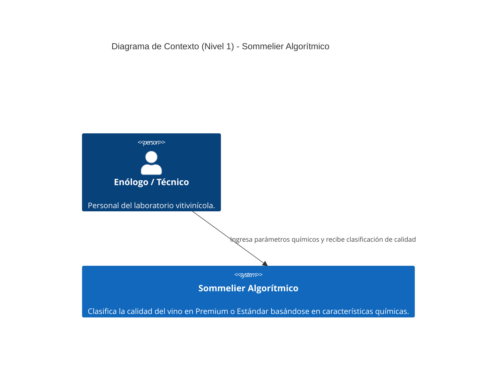
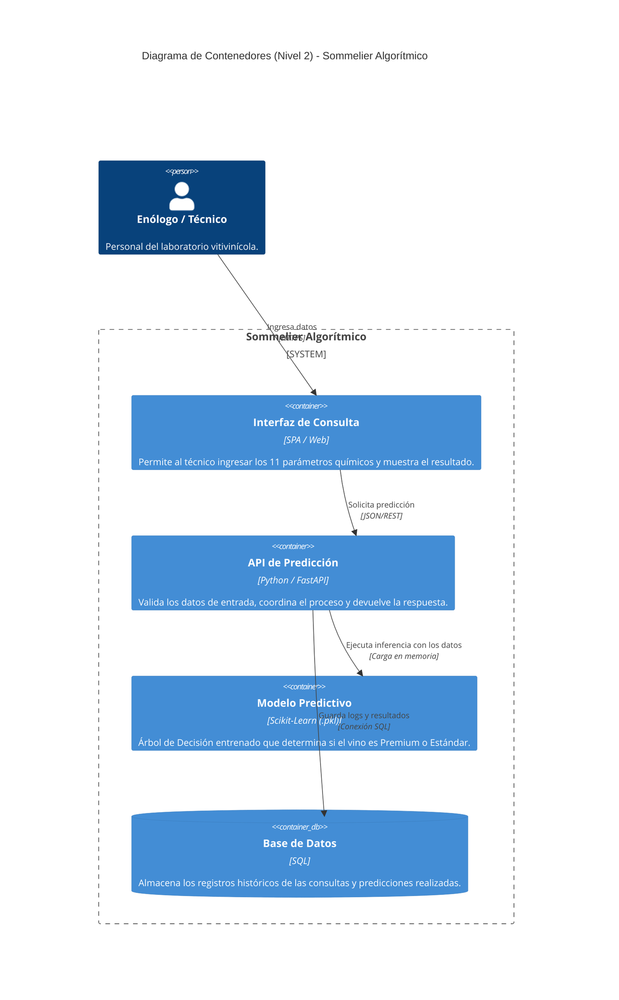
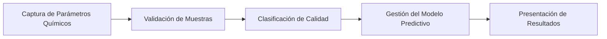
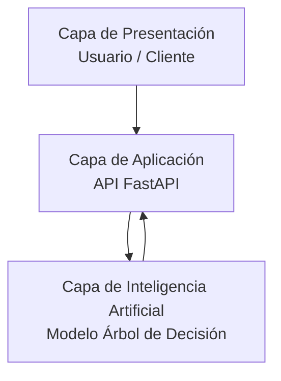

# Proyecto Final: Sommelier Algorítmico - Control de Calidad Automatizado para Viñedos
**Materia:** Teoría de la Computación  
**Estudiantes:**
Leonardo Quiroga
Kimberly Moreno
Linda Ortiz

---

## 1. Contexto y Delimitación del Problema

Basándonos en los datasets proporcionados para este proyecto, encontramos información detallada sobre los atributos fisicoquímicos de diferentes variantes de productos, como el vino. A partir de la experiencia en la industria alimentaria y del conocimiento de otros sectores que desarrollan productos con largos periodos de maduración o procesos extensos de fabricación, como la industria del cuidado personal en la producción de jabones y extractos, es sabido que al finalizar el proceso se realizan pruebas para determinar la calidad del producto. Sin embargo, a pesar del tiempo, los recursos y el esfuerzo invertidos, no siempre es posible garantizar que el resultado final cumpla con los estándares establecidos.

Nuestro problema surge precisamente de esta situación. En un mercado globalizado, las empresas deben cumplir con los tiempos exigidos por los clientes sin generar sobrecostos. Cuando un producto no supera las pruebas de calidad al final de su ciclo de producción, es necesario reiniciar el proceso desde cero. Esto implica la pérdida de materias primas, tiempo y recursos, además del riesgo de perder clientes y oportunidades de venta. En el caso del vino, también pueden presentarse afectaciones a la reputación de la empresa debido a retrasos en la entrega o incumplimientos logísticos.

* **Descripción del conjunto de datos:** Se utilizará el *UCI Wine Quality Dataset*, el cual contiene atributos fisicoquímicos de diferentes variantes de vino (Alcohol, Acidez, pH, Sulfatos, etc.).
* **Objetivo:** Clasificar el vino en proceso de maduración como "Premium" o "Estándar" empleando un algoritmo de Machine Learning para predecir la calidad que tendrá de forma automatizada (metodología que también se puede emplear en otros productos, pero hemos decidido enfocarnos en uno). Esto permite anticipar y reducir las fallas durante la producción y así tomar acciones correctivas antes de completar el tiempo de añejamiento.
* **Cambio de procesos:** Se incorpora una herramienta de apoyo a la toma de decisiones basada en Machine Learning que permite realizar una clasificación preliminar de la calidad del vino utilizando únicamente atributos fisicoquímicos. La evaluación sensorial realizada por expertos se mantiene como etapa final de validación del producto (en la industria química de cuidado personal, se mantendrían los análisis típicos que certifican el material como “apto” o de “calidad”).
* **Alcance:** Procesamiento de las 11 variables químicas provistas por el análisis químico, entrenamiento del modelo, evaluación de métricas de Machine Learning y exposición a través de una API local.
* **Exclusiones:** No se procesarán variables sensoriales u organolépticas como lo son el sabor, el color o los aromas. El sistema no hará sugerencias para arreglar el vino ni determinará el precio en el mercado. Tampoco incluye despliegue en un entorno cloud de producción.
* **Criterio de éxito:** Alcanzar una precisión superior al 80% en el conjunto de pruebas, y lograr que la API responda a nuevas consultas de forma correcta.
* **Supuestos:** Los instrumentos que proveen los datos químicos de entrada deben estar correctamente calibrados. Los estándares históricos de la calidad del vino continúan vigentes, representando las preferencias actuales en el mercado.
* **Resultado final del proyecto:** Un modelo de Machine Learning de tipo Árbol de Decisión de clasificación binaria expuesto a través de una API que recibe parámetros químicos y devuelve una categoría de calidad.

> **Meta del Proyecto:** Desarrollar una API de Machine Learning que permita a los laboratorios vitivinícolas predecir de forma inmediata la viabilidad de la calidad de un lote de vino clasificándolo como “Premium” o “Estándar” basándose exclusivamente en sus atributos fisicoquímicos, excluyendo por completo el análisis sensorial.

### 1.1 Identificación de Interesados

| Interesado | Resultado Esperado |
|---|---|
| **Patrocinador** | Prioridad alta en la reducción de costos operativos por lotes deficientes y en agilizar la clasificación inicial para la reposición de producto. También alta prioridad en la precisión para evitar descartar vinos de buena calidad por error. |
| **Usuario final** | El enólogo o técnico del laboratorio debe ingresar los resultados de los tests (11 parámetros) en una interfaz y recibir la predicción al instante de la calidad del vino. |
| **Personal de Operación TI** | Requiere despliegue mediante una API de fácil ejecución y un respaldo del archivo del modelo para recuperación inmediata ante fallas de la API. |
| **Equipo de Seguridad y Datos** | Requiere protección del histórico de calidad de la bodega. Solo el personal de laboratorio autorizado debe poder acceder al sistema para evitar alteraciones o fugas de información. |
| **Equipo de Desarrollo** | El código debe ser modular para permitir reemplazar el modelo entrenado con nuevas versiones sin reescribir la API completa (ejemplo: nuevas cepas de uva, nuevas tendencias del mercado, etc.). |

---

## 2. Definición de la Arquitectura

La arquitectura del Sommelier Algorítmico determina las decisiones de alto impacto y organiza las responsabilidades técnicas. A continuación, se definen los parámetros base aplicados a nuestro proyecto:

| Elemento | Definición en el Proyecto (Sommelier Algorítmico) | Entregable Asociado |
|---|---|---|
| **Contexto** | El sistema clasifica la calidad del vino mediante parámetros químicos. Quedan fuera el análisis sensorial y el despliegue cloud. | Diagrama de contexto (C4 Nivel 1) y alcance |
| **Drivers** | Alta precisión (>80% Accuracy) para evitar pérdidas, baja latencia en respuestas (<1s) y alta modificabilidad. | Lista priorizada de drivers técnicos y riesgos |
| **Estructura** | Frontend ligero (SPA), Backend orquestador (FastAPI), Modelo ML serializado (.pkl) y Base de Datos (SQL). | Diagrama de contenedores (C4 Nivel 2) |
| **Decisiones** | Implementación en Python, uso de Árbol de Decisión por su interpretabilidad gráfica y almacenamiento local. | 3 Registros ADR (Architecture Decision Records) |
| **Evidencia** | Separación de datos Train/Test, evaluación mediante F1-Score/Accuracy, y análisis de Falsos Positivos/Negativos. | Métricas de evaluación de ML y Matriz de Confusión |

---

## 3. Diagramas C4

### Diagrama de Contexto C4
[image]

### Diagrama de Contenedores C4
[image]

---

## 4. Drivers Arquitectónicos

En la identificación de los Drivers Arquitectónicos, el principal driver surge de la necesidad de anticipar problemas de calidad durante el proceso de producción del vino, reduciendo costos asociados al descarte de lotes defectuosos o a la sobreproducción del mismo con la finalidad de cumplir con los pedidos recibidos por los clientes. Así que podríamos decir que el atributo más importante es la precisión del modelo predictivo, estableciendo como criterio de éxito una exactitud superior al 80% en el conjunto de pruebas. 

Igualmente, como segundo driver, la solución debe ofrecer respuestas rápidas para facilitar la toma de decisiones en el laboratorio, puesto que las pruebas químicas podrían tomar días para obtener un resultado, adicionando retrasos en los tiempos.

En cambio, otra de las variables surge como una restricción del proyecto, que sería el uso exclusivo de variables fisicoquímicas (descritas anteriormente) y la implementación mediante una API local (no se desplegará en la nube para este proyecto). Asimismo, como última variable, es importante tener en cuenta que el software debe tener la capacidad de reemplazar el modelo inicial de Machine Learning o extenderse a otros tipos de productos (tipo de vinos, uvas, nuevas tendencias, etc.) sin modificar la arquitectura existente.

---

## 5. Atributos de Calidad

* **Driver 1 - Precisión del modelo:** Cuando el laboratorio envía los datos de un lote que terminará siendo Premium, en el conjunto de prueba el sistema lo clasifica correctamente como Premium, con un acierto de al menos 70% sobre los vinos Premium reales.
* **Driver 2 - Rapidez en arrojar resultados:** Cuando el técnico envía los 11 parámetros de una muestra en el uso normal del laboratorio, el sistema devuelve la clasificación con un tiempo de respuesta menor a 5 segundos.
* **Driver 3 - Restricciones:** Cuando se ejecuta el sistema, este recibe solo las 11 variables fisicoquímicas definidas, con 0 dependencias de servicios en la nube.
* **Driver 4 - Modelo reemplazable:** Cuando el equipo necesite reemplazar el modelo por uno nuevo, el sistema acepta el nuevo modelo sin cambios en el código de la API (0 líneas de la API modificadas).

---

# Proyecto Final: Sommelier Algorítmico - Control de Calidad Automatizado para Viñedos
**Materia:** Teoría de la Computación  
**Estudiantes:**
Leonardo Quiroga
Kimberly Moreno
Linda Ortiz

---

## 1. Contexto y Delimitación del Problema

Basándonos en los datasets proporcionados para este proyecto, encontramos información detallada sobre los atributos fisicoquímicos de diferentes variantes de productos, como el vino. A partir de la experiencia en la industria alimentaria y del conocimiento de otros sectores que desarrollan productos con largos periodos de maduración o procesos extensos de fabricación, como la industria del cuidado personal en la producción de jabones y extractos, es sabido que al finalizar el proceso se realizan pruebas para determinar la calidad del producto. Sin embargo, a pesar del tiempo, los recursos y el esfuerzo invertidos, no siempre es posible garantizar que el resultado final cumpla con los estándares establecidos.

Nuestro problema surge precisamente de esta situación. En un mercado globalizado, las empresas deben cumplir con los tiempos exigidos por los clientes sin generar sobrecostos. Cuando un producto no supera las pruebas de calidad al final de su ciclo de producción, es necesario reiniciar el proceso desde cero. Esto implica la pérdida de materias primas, tiempo y recursos, además del riesgo de perder clientes y oportunidades de venta. En el caso del vino, también pueden presentarse afectaciones a la reputación de la empresa debido a retrasos en la entrega o incumplimientos logísticos.

* **Descripción del conjunto de datos:** Se utilizará el *UCI Wine Quality Dataset*, el cual contiene atributos fisicoquímicos de diferentes variantes de vino (Alcohol, Acidez, pH, Sulfatos, etc.).
* **Objetivo:** Clasificar el vino en proceso de maduración como "Premium" o "Estándar" empleando un algoritmo de Machine Learning para predecir la calidad que tendrá de forma automatizada (metodología que también se puede emplear en otros productos, pero hemos decidido enfocarnos en uno). Esto permite anticipar y reducir las fallas durante la producción y así tomar acciones correctivas antes de completar el tiempo de añejamiento.
* **Cambio de procesos:** Se incorpora una herramienta de apoyo a la toma de decisiones basada en Machine Learning que permite realizar una clasificación preliminar de la calidad del vino utilizando únicamente atributos fisicoquímicos. La evaluación sensorial realizada por expertos se mantiene como etapa final de validación del producto (en la industria química de cuidado personal, se mantendrían los análisis típicos que certifican el material como “apto” o de “calidad”).
* **Alcance:** Procesamiento de las 11 variables químicas provistas por el análisis químico, entrenamiento del modelo, evaluación de métricas de Machine Learning y exposición a través de una API local.
* **Exclusiones:** No se procesarán variables sensoriales u organolépticas como lo son el sabor, el color o los aromas. El sistema no hará sugerencias para arreglar el vino ni determinará el precio en el mercado. Tampoco incluye despliegue en un entorno cloud de producción.
* **Criterio de éxito:** Alcanzar una precisión superior al 80% en el conjunto de pruebas, y lograr que la API responda a nuevas consultas de forma correcta.
* **Supuestos:** Los instrumentos que proveen los datos químicos de entrada deben estar correctamente calibrados. Los estándares históricos de la calidad del vino continúan vigentes, representando las preferencias actuales en el mercado.
* **Resultado final del proyecto:** Un modelo de Machine Learning de tipo Árbol de Decisión de clasificación binaria expuesto a través de una API que recibe parámetros químicos y devuelve una categoría de calidad.

> **Meta del Proyecto:** Desarrollar una API de Machine Learning que permita a los laboratorios vitivinícolas predecir de forma inmediata la viabilidad de la calidad de un lote de vino clasificándolo como “Premium” o “Estándar” basándose exclusivamente en sus atributos fisicoquímicos, excluyendo por completo el análisis sensorial.

### 1.1 Identificación de Interesados

| Interesado | Resultado Esperado |
|---|---|
| **Patrocinador** | Prioridad alta en la reducción de costos operativos por lotes deficientes y en agilizar la clasificación inicial para la reposición de producto. También alta prioridad en la precisión para evitar descartar vinos de buena calidad por error. |
| **Usuario final** | El enólogo o técnico del laboratorio debe ingresar los resultados de los tests (11 parámetros) en una interfaz y recibir la predicción al instante de la calidad del vino. |
| **Personal de Operación TI** | Requiere despliegue mediante una API de fácil ejecución y un respaldo del archivo del modelo para recuperación inmediata ante fallas de la API. |
| **Equipo de Seguridad y Datos** | Requiere protección del histórico de calidad de la bodega. Solo el personal de laboratorio autorizado debe poder acceder al sistema para evitar alteraciones o fugas de información. |
| **Equipo de Desarrollo** | El código debe ser modular para permitir reemplazar el modelo entrenado con nuevas versiones sin reescribir la API completa (ejemplo: nuevas cepas de uva, nuevas tendencias del mercado, etc.). |

---

## 2. Definición de la Arquitectura

La arquitectura del Sommelier Algorítmico determina las decisiones de alto impacto y organiza las responsabilidades técnicas. A continuación, se definen los parámetros base aplicados a nuestro proyecto:

| Elemento | Definición en el Proyecto (Sommelier Algorítmico) | Entregable Asociado |
|---|---|---|
| **Contexto** | El sistema clasifica la calidad del vino mediante parámetros químicos. Quedan fuera el análisis sensorial y el despliegue cloud. | Diagrama de contexto (C4 Nivel 1) y alcance |
| **Drivers** | Alta precisión (>80% Accuracy) para evitar pérdidas, baja latencia en respuestas (<1s) y alta modificabilidad. | Lista priorizada de drivers técnicos y riesgos |
| **Estructura** | Frontend ligero (SPA), Backend orquestador (FastAPI), Modelo ML serializado (.pkl) y Base de Datos (SQL). | Diagrama de contenedores (C4 Nivel 2) |
| **Decisiones** | Implementación en Python, uso de Árbol de Decisión por su interpretabilidad gráfica y almacenamiento local. | 3 Registros ADR (Architecture Decision Records) |
| **Evidencia** | Separación de datos Train/Test, evaluación mediante F1-Score/Accuracy, y análisis de Falsos Positivos/Negativos. | Métricas de evaluación de ML y Matriz de Confusión |

---

## 3. Diagramas C4

### Diagrama de Contexto C4

### Diagrama de Contenedores C4

---

## 4. Drivers Arquitectónicos

En la identificación de los Drivers Arquitectónicos, el principal driver surge de la necesidad de anticipar problemas de calidad durante el proceso de producción del vino, reduciendo costos asociados al descarte de lotes defectuosos o a la sobreproducción del mismo con la finalidad de cumplir con los pedidos recibidos por los clientes. Así que podríamos decir que el atributo más importante es la precisión del modelo predictivo, estableciendo como criterio de éxito una exactitud superior al 80% en el conjunto de pruebas. 

Igualmente, como segundo driver, la solución debe ofrecer respuestas rápidas para facilitar la toma de decisiones en el laboratorio, puesto que las pruebas químicas podrían tomar días para obtener un resultado, adicionando retrasos en los tiempos.

En cambio, otra de las variables surge como una restricción del proyecto, que sería el uso exclusivo de variables fisicoquímicas (descritas anteriormente) y la implementación mediante una API local (no se desplegará en la nube para este proyecto). Asimismo, como última variable, es importante tener en cuenta que el software debe tener la capacidad de reemplazar el modelo inicial de Machine Learning o extenderse a otros tipos de productos (tipo de vinos, uvas, nuevas tendencias, etc.) sin modificar la arquitectura existente.

---

## 5. Atributos de Calidad

* **Driver 1 - Precisión del modelo:** Cuando el laboratorio envía los datos de un lote que terminará siendo Premium, en el conjunto de prueba el sistema lo clasifica correctamente como Premium, con un acierto de al menos 70% sobre los vinos Premium reales.
* **Driver 2 - Rapidez en arrojar resultados:** Cuando el técnico envía los 11 parámetros de una muestra en el uso normal del laboratorio, el sistema devuelve la clasificación con un tiempo de respuesta menor a 5 segundos.
* **Driver 3 - Restricciones:** Cuando se ejecuta el sistema, este recibe solo las 11 variables fisicoquímicas definidas, con 0 dependencias de servicios en la nube.
* **Driver 4 - Modelo reemplazable:** Cuando el equipo necesite reemplazar el modelo por uno nuevo, el sistema acepta el nuevo modelo sin cambios en el código de la API (0 líneas de la API modificadas).

---

## 6. Diseño de la Arquitectura Lógica

### Componentes Identificados
| Componente | Responsabilidad |
|---|---|
| **Interfaz de Consulta** | Permitir al técnico ingresar los parámetros químicos y visualizar el resultado. |
| **Motor de Clasificación** | Procesar los datos y determinar si el vino es Premium o Estándar. |
| **Modelo Predictivo** | Contener el conocimiento entrenado y ejecutar la inferencia. |

### Asignación de Capacidades
| Capacidad | Componente Responsable |
|---|---|
| Ingreso de parámetros químicos | Interfaz de Consulta |
| Validación de datos de entrada | Motor de Clasificación |
| Solicitud de predicción | Motor de Clasificación |
| Clasificación Premium / Estándar | Modelo Predictivo |
| Presentación de resultados | Interfaz de Consulta |

### Cohesión
Los componentes propuestos presentan una alta cohesión debido a que cada uno tiene una única responsabilidad claramente definida:
* **Captura de Parámetros Químicos:** Solo recibe información.
* **Validación de Muestras:** Solo verifica los datos.
* **Clasificación de Calidad:** Únicamente toma decisiones sobre la categoría del vino.
* **Gestión del Modelo Predictivo:** Administra el modelo entrenado.
* **Presentación de Resultados:** Solamente comunica la predicción al usuario.

### Acoplamiento
El sistema presenta un bajo acoplamiento debido a que cada componente depende únicamente de la información proporcionada por el componente anterior.

**Flujo lógico:**  
`Captura de Parámetros → Validación de Muestras → Clasificación de Calidad → Gestión del Modelo → Presentación de Resultados`

### Asignación de Drivers Arquitectónicos
| Componente | Responsabilidad Principal |
|---|---|
| **Interfaz de Consulta** | Capturar información del análisis químico. |
| **API de Predicción** | Coordinar el flujo de validación y clasificación. |
| **Modelo Predictivo** | Generar la predicción de calidad. |

---

## 7. Registros de Decisiones de Arquitectura (ADR)

### Arquitectura Seleccionada
Se seleccionó una arquitectura en capas porque permite separar la interacción con el usuario, el procesamiento de las solicitudes y la lógica del modelo de Machine Learning, facilitando el mantenimiento por un equipo y la evolución del sistema por partes sin afectar otras áreas. La arquitectura se organiza de la siguiente manera:

1. **Capa de Presentación:** Recibe los parámetros ingresados por el usuario y muestra los resultados.
2. **Capa de Aplicación:** Valida los datos que recibe, gestiona la ejecución de la predicción y coordina la comunicación entre el modelo y la capa de presentación.
3. **Capa de Inteligencia Artificial:** Ejecuta el modelo de Árbol de Decisión ya entrenado y genera el resultado de la clasificación Premium o Estándar.

---

## 8. Selección de Tácticas para los Escenarios Prioritarios

| Escenario | Táctica | Efecto y Costo |
|---|---|---|
| Alcanzar una exactitud superior al 80% en la clasificación de vinos | Entrenamiento y validación del modelo utilizando conjuntos separados de entrenamiento y prueba. | Incrementa la confiabilidad de las predicciones; requiere tiempo adicional de experimentación y evaluación. |
| Responder consultas en menos de 5 segundos | Cargar el modelo entrenado en memoria al iniciar la aplicación. | Reduce los tiempos de respuesta; incrementa ligeramente el consumo de memoria. |
| Evitar errores causados por datos inválidos | Validación de los once parámetros fisicoquímicos antes de ejecutar la predicción. | Mejora la robustez del sistema, evita errores y agrega lógica de validación. |
| Facilitar el reemplazo del modelo predictivo | Separar la lógica de la API del archivo del modelo (.pkl). | Facilita las actualizaciones del modelo. |
| Garantizar la correcta operación de la API | Registro de las solicitudes hechas y errores. | Facilita el diagnóstico futuro y mantenimiento; genera archivos adicionales. |

---

## 9. Registro de Decisiones y Trade-offs (ADR)

Para nuestro registro de decisiones se toman dos que son esenciales para nuestro proyecto: el primero es la adopción de una arquitectura en capas, y el segundo la selección de un Árbol de Decisión como modelo de clasificación. Además, se documentan detalles de implementación técnica, selección de ecosistema y almacenamiento.

| Campo del ADR | Contenido |
|---|---|
| **Título y estado** | **ADR-01: Adopción de una arquitectura en capas para el sistema Sommelier Algorítmico.** (Aceptada) |
| **Contexto** | El proyecto requiere clasificar vinos como Premium o Estándar mediante un modelo de Machine Learning expuesto a través de una API local. Los drivers principales son la precisión del modelo, la rapidez de respuesta y la mantenibilidad del sistema. Entre las alternativas consideradas se evaluaron microservicios, arquitectura orientada a eventos y monolito modular. |
| **Decisión** | Se adopta una arquitectura en capas compuesta por una capa de presentación, una capa de aplicación y una capa de Machine Learning. La API actuará como intermediaria entre el usuario y el modelo predictivo. |
| **Consecuencias** | **Beneficios:** Implementación sencilla, fácil mantenimiento, menor complejidad y facilidad para reemplazar el modelo en futuras versiones. **Costos o trade-offs:** Menor capacidad de escalamiento independiente en comparación con microservicios y mayor dependencia entre componentes ejecutados en el mismo entorno. |
| **Validación** | La decisión se considerará adecuada si la arquitectura permite alcanzar una precisión superior al 80% en las pruebas del modelo, responder consultas en menos de 5 segundos y permitir la sustitución del modelo sin modificar la interfaz de la API. |

| Campo del ADR | Contenido |
|---|---|
| **Título y estado** | **ADR-02: Utilización de un Árbol de Decisión como modelo de clasificación.** (Aceptada) |
| **Contexto** | El sistema debe clasificar vinos utilizando únicamente variables fisicoquímicas y generar resultados comprensibles para los interesados del proyecto. |
| **Decisión** | Utilizar un algoritmo de Árbol de Decisión entrenado con el *UCI Wine Quality Dataset* para la clasificación binaria Premium/Estándar. |
| **Consecuencias** | **Beneficios:** Fácil interpretación, tiempos de inferencia bajos y simplicidad de implementación. **Trade-offs:** Puede ofrecer menor precisión que modelos más complejos como Random Forest o XGBoost. |
| **Validación** | Comparar la precisión, recall y F1-score obtenidos durante la fase de evaluación del modelo. |

| Campo del ADR | Contenido |
|---|---|
| **Título y estado** | **ADR-03: Enfoque de Implementación (Python, FastAPI y Scikit-Learn)** (Aceptada) |
| **Contexto** | Se requiere un ecosistema con soporte nativo para EDA (Análisis Exploratorio de Datos) y despliegue rápido de endpoints. |
| **Decisión** | Python fue seleccionado sobre otros lenguajes debido a su madurez en Machine Learning y su integración ágil. |
| **Consecuencias** | Aumenta la velocidad de desarrollo, aunque exige un estricto control de versiones de paquetes y dependencias. |
| **Validación** | Construcción de una API funcional probada localmente. |

| Campo del ADR | Contenido |
|---|---|
| **Título y estado** | **ADR-04: Almacenamiento y Despliegue (Serialización .pkl)** (Aceptada) |
| **Contexto** | Se requiere que el sistema prediga resultados rápidamente sin tener que re-entrenar el modelo con cada solicitud HTTP entrante. |
| **Decisión** | Exportar el modelo a un archivo binario `.pkl` (Pickle). |
| **Consecuencias** | Optimiza el tiempo de respuesta (latencia), pero crea el riesgo de incompatibilidades si la versión de Scikit-Learn cambia en producción. |
| **Validación** | Ejecución de predicciones en menos de 1 segundo de latencia. |

---

## 10. Riesgos Técnicos y Mitigación

Para la implementación de este proyecto identificamos tres riesgos principales que pueden afectar el rendimiento del modelo, junto con la forma en que los vamos a manejar en el código:

1. **Datos Desbalanceados:** Revisando el dataset de la UCI, la gran mayoría de los vinos tienen una calificación media (5 o 6), y hay muy pocos ejemplos de vinos "Premium" reales. El riesgo aquí es que el modelo se vuelva perezoso y asuma probabilísticamente que casi todo es calidad estándar. Para mitigarlo, podemos usar técnicas de sobremuestreo como SMOTE para balancear las clases, o utilizar el parámetro `class_weight` para que el modelo penalice más equivocarse con un vino Premium.
2. **Sobreajuste (Overfitting):** Los árboles de decisión tienden a crecer demasiado y aprenderse los datos de entrenamiento de memoria. Si esto pasa, el modelo funcionaría perfecto en nuestro entorno local, pero fallaría al evaluar nuevos vinos en un laboratorio real. La mitigación más directa es limitar qué tanto puede crecer el árbol, ajustando el hiperparámetro de profundidad máxima (por ejemplo, `max_depth = 5`) al momento de entrenarlo en Scikit-Learn.
3. **Fuga de Información (Data Leakage):** Si por error mezclamos los datos y el modelo llega a ver la información de prueba durante su entrenamiento, las métricas nos van a mentir diciendo que el modelo es casi perfecto. Para evitar este engaño, desde la etapa de preparación de datos aplicamos un `train_test_split` estricto (separando el 20% de los datos solo para evaluación final) y nos aseguramos de no hacer ninguna transformación global antes de dividir el dataset.

---

## 11. Calidad y Evaluación del Modelo

Para evaluar qué tan bien funciona nuestro modelo de clasificación, decidimos no quedarnos solo con el *Accuracy* (Exactitud), ya que como mencionamos antes, los datos están desbalanceados (hay muchos más vinos normales que excelentes). Por eso, nos trazamos la meta de superar el 80% en cuatro métricas clave para asegurar que el modelo sirva en la vida real:

* **Accuracy (Exactitud):** Nos dice el porcentaje total de veces que nuestro modelo acertó, ya sea prediciendo correctamente un vino Premium o uno Estándar.
* **Precision (Precisión):** De todos los vinos que nuestro modelo etiquetó como "Premium", ¿cuántos lo eran realmente? Esto es clave para no embotellar un vino malo haciéndolo pasar por uno caro.
* **Recall (Exhaustividad):** De todos los vinos que *realmente* eran Premium en el viñedo, ¿cuántos logró detectar nuestro modelo? La idea es que no se nos escape ninguno bueno.
* **F1-Score:** Es un promedio armónico entre Precision y Recall. Es la métrica en la que más nos fijamos para saber si el modelo es estable y no nos está mintiendo por culpa del desbalance de datos.

**¿Cómo interpretamos la Matriz de Confusión en este proyecto?**
Para entender los errores y aciertos del algoritmo desde el punto de vista del negocio de la bodega, planteamos la matriz así:
* **Verdadero Positivo (VP):** Nuestro algoritmo dice que es un vino Premium, y efectivamente lo es. ¡Perfecto para vender a buen precio!
* **Falso Positivo (FP):** Nuestro algoritmo predice que es Premium, pero en realidad el vino es de mala calidad. Este es un riesgo gravísimo porque destruiría el prestigio de la bodega si un cliente exigente lo compra.
* **Verdadero Negativo (VN):** El algoritmo descarta el vino como "Estándar" y acierta, ya que efectivamente era de calidad media o baja.
* **Falso Negativo (FN):** El algoritmo rechaza el vino diciendo que es Estándar, pero en la vida real era un Premium excelente. Aquí la bodega pierde plata al vender un producto de alta gama a precio de supermercado.

---

## 12. Análisis Ético y Conclusiones

Como equipo de trabajo, decidimos no cerrar el proyecto únicamente mostrando código y diagramas, sino también analizando el impacto real que tendría nuestro *Sommelier Algorítmico* si una bodega vitivinícola lo implementara en la vida real. Tras nuestra evaluación, llegamos a las siguientes conclusiones:

* **Balance Técnico y de Negocio:** A nivel de ingeniería, logramos diseñar una arquitectura que cumple con los objetivos principales: es modular, responde rápido y ayuda al viñedo a predecir la calidad de un lote para evitar perder tiempo y dinero en el añejamiento de productos defectuosos. Sin embargo, reconocemos que las métricas de Machine Learning son solo una parte del éxito del sistema.
* **Equidad y el Sesgo Industrial:** Nos dimos cuenta de que depender exclusivamente de variables fisicoquímicas crea un sesgo fuerte hacia la "estandarización". Si usamos el modelo a ciegas, terminaríamos castigando a los vinos artesanales o ecológicos, que por naturaleza presentan más variaciones en su pH o acidez. El sistema podría etiquetarlos erróneamente como de baja calidad solo porque no encajan en la fórmula matemática perfecta de una fábrica grande.
* **Impacto Social y Cultural:** Debatimos sobre lo perjudicial que sería intentar automatizar o reemplazar el trabajo de los catadores con nuestro algoritmo. Reducir la calidad de un vino a simples datos estadísticos le quita todo el valor humano y tradicional a la enología, y podría empujar al mercado a producir vinos genéricos solo para "complacer a la máquina".
* **Reflexión y Recomendación Final:** Por todo lo anterior, concluimos que nuestra herramienta debe catalogarse estrictamente como un sistema de apoyo a la toma de decisiones. El objetivo principal del software es ahorrarle costos de laboratorio a la empresa detectando de forma temprana lo que evidentemente está dañado; pero **nunca** debe reemplazar el paladar humano. La cata final y la última palabra sobre el producto siempre debe tenerla el experto enólogo.